<p align="center">
  
</p>

<h1 align="center">Select</h1>

<p align="center"><strong>Run your company with AI agents that earn their autonomy.</strong></p>

<p align="center">
Agents of any kind — developers, marketers, support, sales — work in an organization you design. Every result is checked by code against a delivery contract,
and an agent stops needing your approval only once its verified record shows it can — per task type, revocable at any time.
</p>

<p align="center">
  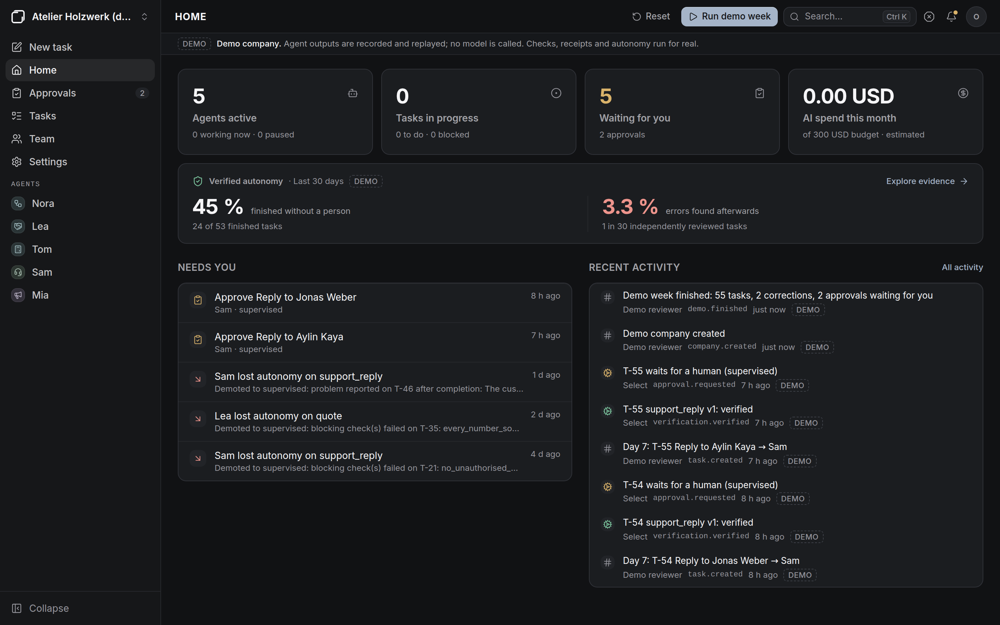
</p>

> **Status: 0.2.** Accounts, guided setup, local IMAP/SMTP mail tests, routines and the verification loop are covered by end-to-end tests. Docker images build and the Compose stack starts successfully in Ubuntu GitHub Actions CI. Real model API calls have not been verified yet: see [Limits](#limits).

## Why Select

Multi-agent orchestrators let you decide in advance what agents may do alone. Select replaces that guess with evidence:

- **Delivery contracts.** Each task type has a YAML contract. The system runs its checks itself and keeps a **receipt** — contract version and hash, every check, the evidence. A model never declares that a check passed.
- **Autonomy earned per agent and task type.** Supervised → sampled → autonomous after a streak of verified successes; back to supervised at the first blocking failure or human correction.
- **Limits the score never overrides.** Payments, contracts, taxes and hiring are always supervised, in code.
- **An honest counter.** The share of work finished without a person is always shown next to the rate of errors people found afterwards.
- **No invented numbers.** Every value carries its source; a quantity that is not in the customer's e-mail fails verification.

## What it does

| | |
| --- | --- |
| Start | First visit creates the owner; guided setup: country (VAT, currency, time zone, language), a starting team, an AI model, a mailbox, a catalog |
| Agents | Any role and model (Anthropic, OpenAI, Gemini, Ollama), org chart, permissions, budgets; a submission API for agents that run elsewhere |
| Work | Tasks from you, from incoming e-mail or from routines; list and board, projects, goals, comments, history |
| Mail | Reads a real mailbox (IMAP), triages, routes by code, prepares replies and quotes, sends once over SMTP after approval |
| Verification | `select-verify`: deterministic rules, exact-decimal money, VAT rates, provenance, receipts |
| Autonomy | Licences, promotion and demotion with reasons, sampling, risk caps, revocation, the counter |
| Approvals | The exact e-mail or content that would leave Select, the reason a person is asked, the proof |
| Team | Password sign-in, invitations, roles, API tokens |
| Operations | Costs and budgets with hard stop, emergency stop, audit log with CSV export |
| Demo | A recorded week in a fictional workshop, no API key |

<table>
  <tr>
    <td width="50%">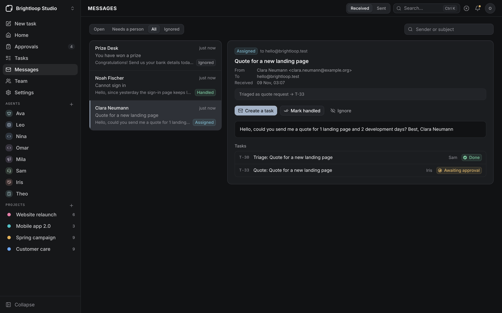</td>
    <td width="50%">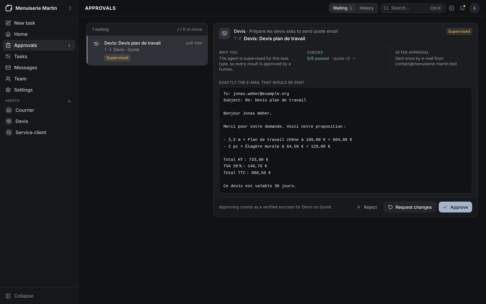</td>
  </tr>
  <tr>
    <td>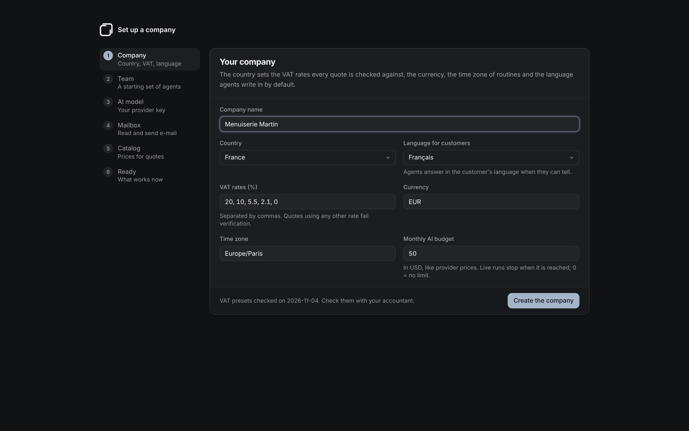</td>
    <td>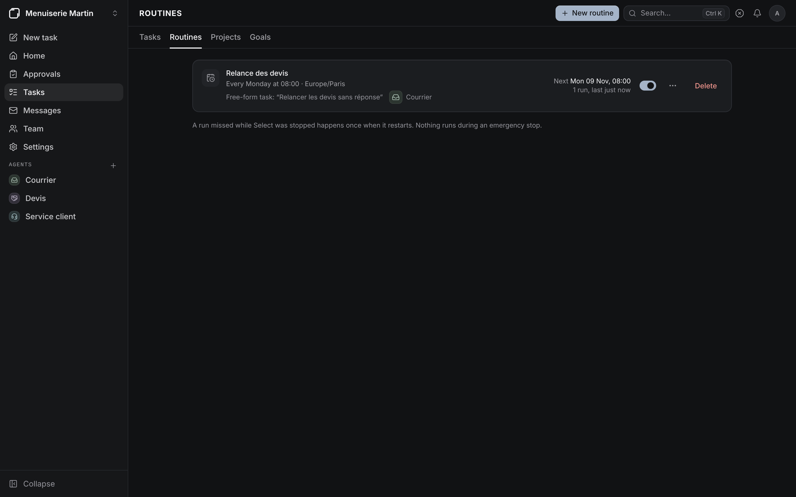</td>
  </tr>
</table>

These four come from the end-to-end test run against local IMAP and SMTP test servers (`E2E_SCREENSHOTS_DIR`); the others are the demo company. All are real captures.

## Quickstart

Requirements: Docker Desktop (Windows, macOS) or Docker Engine with Compose (Linux).

```bash
git clone https://github.com/Kirby54/Select.git select
cd select
./start.sh                 # Windows: .\start.ps1
```

The script writes `.env` with random secrets (keep a copy), starts the containers and opens <http://localhost:3000>, where the first visit creates your account. Without the script: `cp .env.example .env`, set the secrets, `docker compose up --build`.

No API key yet? Open the demo company from the account menu and press **Run demo week**.

Five-minute guide: [docs/getting-started.md](docs/getting-started.md). Development setup without Docker: [docs/installation.md](docs/installation.md).

## How autonomy works

| Level | A verified result… |
| --- | --- |
| Supervised | goes to a person |
| Sampled | goes to a person if picked (default 20 %), otherwise finishes |
| Autonomous | finishes; a person can revoke the licence at once |

Default promotion thresholds are 20 and 50 verified successes in a row — **starting hypotheses to calibrate, not proven values**. An e-mail to an address that never wrote to you always goes to a person. Details: [docs/autonomy.md](docs/autonomy.md).

<p align="center">
  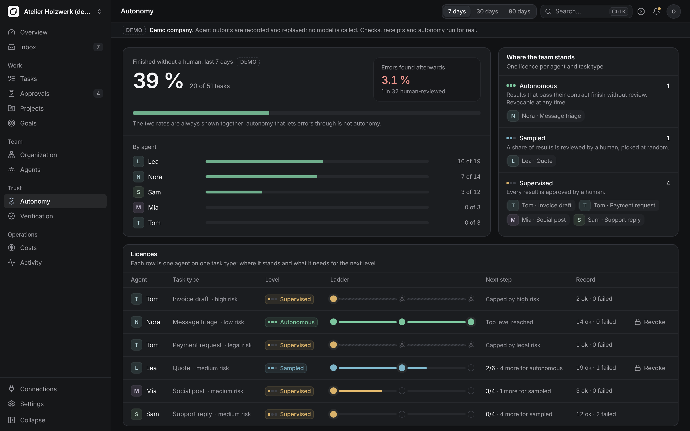
</p>

<table>
  <tr>
    <td width="50%">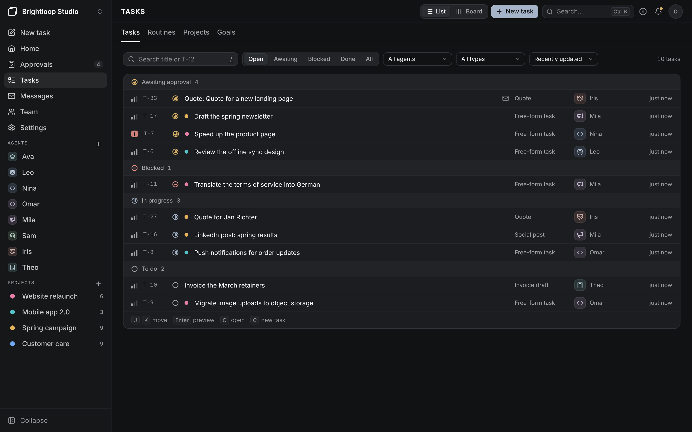</td>
    <td width="50%">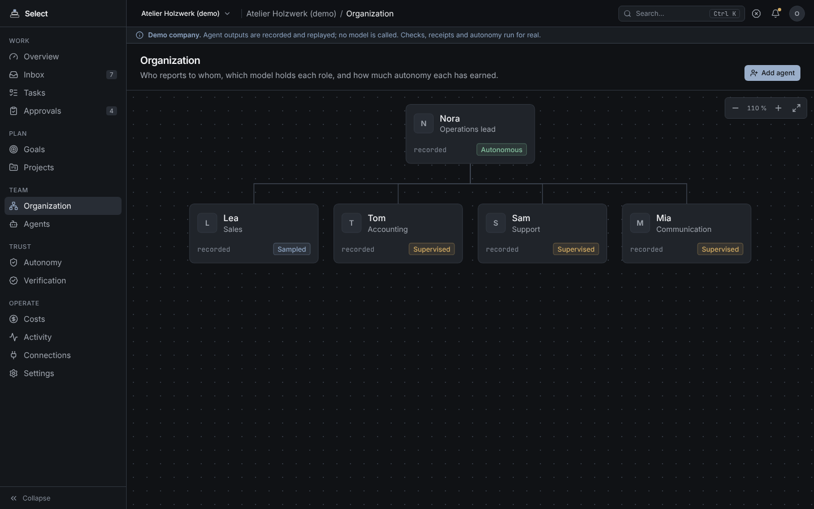</td>
  </tr>
  <tr>
    <td>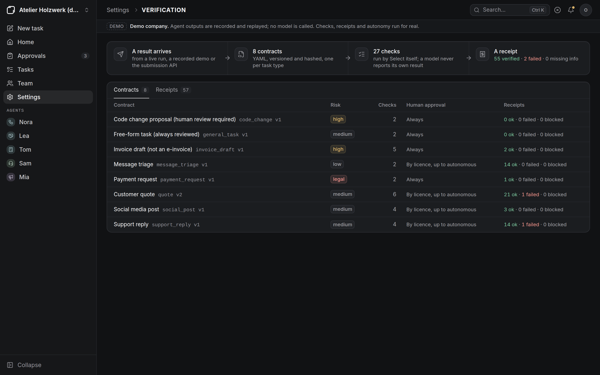</td>
    <td>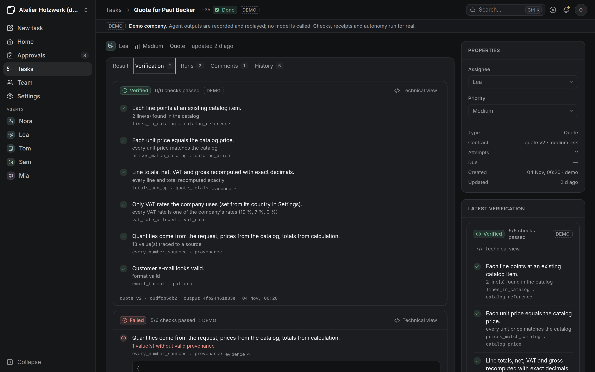</td>
  </tr>
</table>

<p align="center">
  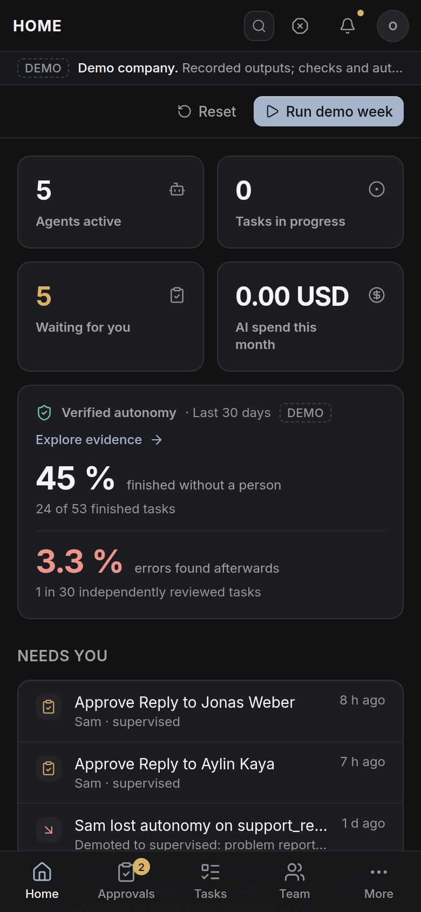
  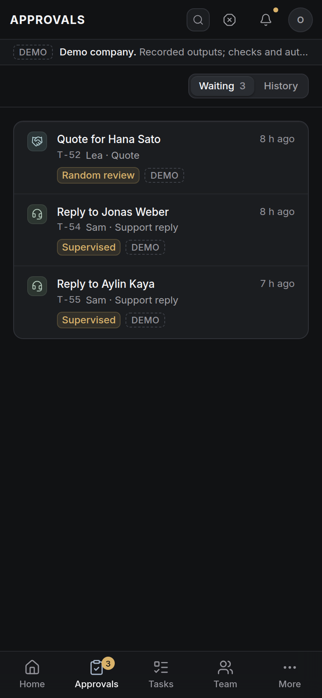
</p>

## A contract

```yaml
id: support_reply
version: 1
title: Support reply
risk: medium
required: [to, subject, body]
checks:
  - id: recipient_from_message
    rule: provenance          # the address must be the one that wrote to us
    params: { fields: [to] }
  - id: no_unauthorised_promises
    rule: forbidden_phrases
    params: { field: body, phrases: ["refund", "discount", "guarantee"] }
approval:
  mode: by_autonomy
  external_action: send_email
```

More in [docs/verification.md](docs/verification.md).

## Architecture

Next.js 16 web app → FastAPI API → PostgreSQL 16, with a worker on a durable PostgreSQL job queue that runs agents, reads mailboxes, sends approved e-mail and fires routines. `select-verify` is a separate Python library with no database or network access. See [docs/architecture.md](docs/architecture.md) and the interface's [design system](docs/design-system.md).

## Security

Agents never hold a permission to send, pay or sign; the server applies the approval rules and sends. External content is treated as data and checked against stored sources. Passwords use Argon2id; sessions live in an HttpOnly cookie with an anti-forgery header; provider keys and mailbox passwords are encrypted. Read [docs/security.md](docs/security.md) and [docs/deployment.md](docs/deployment.md) before opening Select to a network.

## Tests

```bash
make test     # 79 Python tests on PostgreSQL + 20 frontend unit tests
make e2e      # 7 Playwright scenarios against a running stack
```

`e2e/complete.spec.ts` (4 more scenarios) runs on a password-mode stack with the local mail servers of `scripts/dev-mail.py`: first owner, guided setup, a real IMAP mailbox, an e-mail triaged, routed, quoted, approved and sent once over SMTP (the `.eml` file is checked), a weekly routine seen from a New York browser on Paris time, and an invited colleague joining.

## Benchmarks

None published yet. The protocol (`autonomy-bench`: same tasks and models, autonomy rate and undetected-error rate side by side, compared with a single agent and with Paperclip) is in [bench/README.md](bench/README.md). Until it runs, Select makes no comparative claim. Feature parity is tracked honestly in [docs/parity.md](docs/parity.md).

## Limits

- **Provider calls** have not been exercised against the real APIs (no keys in the build environment); the runner is tested with a double replacing only the network call.
- **Docker**: GitHub Actions builds both images, starts PostgreSQL, API, worker and web with Compose, and reaches the API health endpoint through the web proxy on Ubuntu. The `start.sh` script itself was tested with a stand-in Docker CLI; real macOS/Windows installations and `start.ps1` have not been exercised in CI.
- **Mailboxes** were tested against local IMAP and SMTP servers, not yet at a real provider. No OAuth: Microsoft 365 and Outlook.com cannot connect yet; Gmail needs an app password.
- **Agents write text and structured results through model APIs.** They do not work in a code repository yet (no Claude Code or Codex runtime); such agents can submit results through the API.
- Attachments are not read; quotes are sent as e-mail text, without a PDF.
- **No e-invoice**: the invoice draft is not an XRechnung or ZUGFeRD file and is never presented as compliant. Businesses exempt from VAT (*franchise en base*) are not handled properly yet.
- No single sign-on, two-factor authentication, plugins or sandboxed code execution.

## Documentation

[Five minutes](docs/getting-started.md) · [Installation](docs/installation.md) · [Configuration](docs/configuration.md) · [Mail](docs/mail.md) · [Agents](docs/agents.md) · [Autonomy](docs/autonomy.md) · [Verification](docs/verification.md) · [Workflows and routines](docs/workflows.md) · [Architecture](docs/architecture.md) · [Deployment](docs/deployment.md) · [Security](docs/security.md) · [Troubleshooting](docs/troubleshooting.md) · [Design system](docs/design-system.md) · [Français](docs/fr/README.md)

## Contributing

Start with [CONTRIBUTING.md](CONTRIBUTING.md). Good first contributions: a new contract for a task type you know, or a new deterministic rule — each with one accepted and one rejected example.

## Roadmap

1. Verify with real model keys and real mailboxes; build the Docker images in CI.
2. Coding-agent runtimes: run Claude Code or Codex in a code workspace, verify with the project's tests, approve the exact diff.
3. Run without Docker (embedded database), like a one-command install.
4. Quote PDFs, attachments, OAuth mailboxes, VAT-exempt businesses.
5. Run `autonomy-bench` and publish the raw results.

## Licence

The application (`apps/`) is licensed under **AGPL-3.0-only** ([LICENSE](LICENSE)). The `select-verify` library is licensed under **Apache-2.0** ([packages/select-verify/LICENSE](packages/select-verify/LICENSE)) so that other tools can adopt delivery contracts freely.

## Support

Questions and ideas: GitHub Discussions. Bugs: GitHub Issues. Vulnerabilities: privately, see [SECURITY.md](SECURITY.md).
