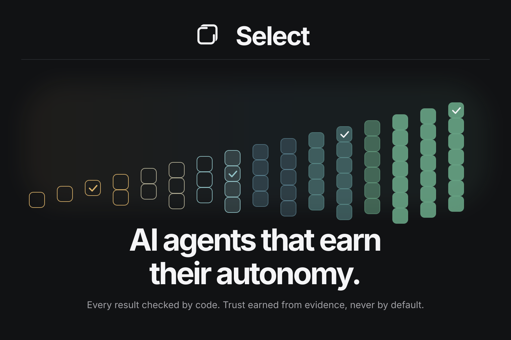
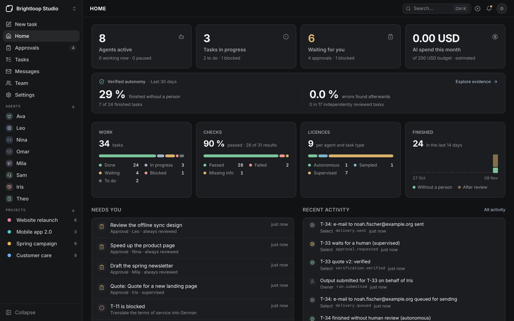
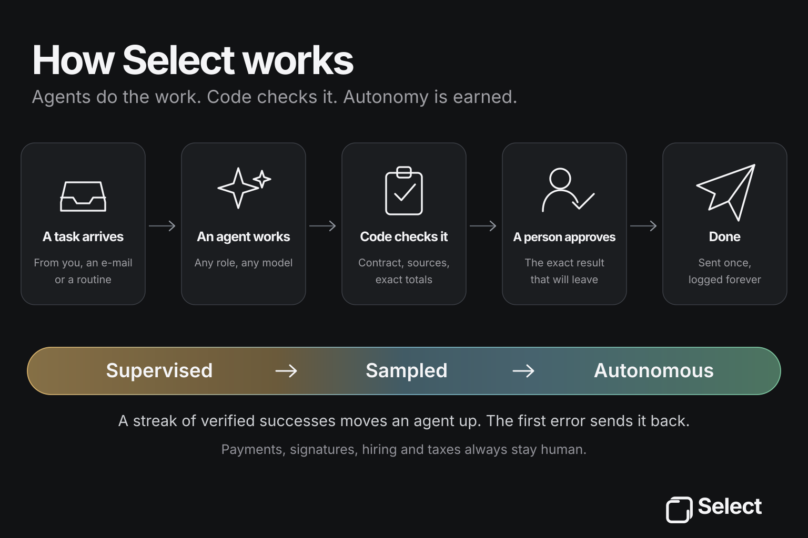
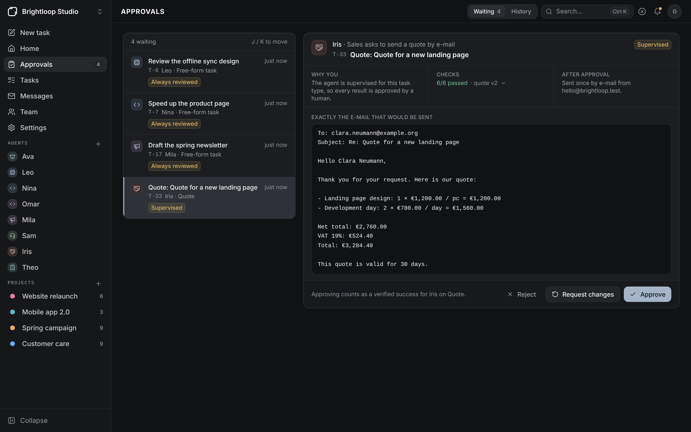
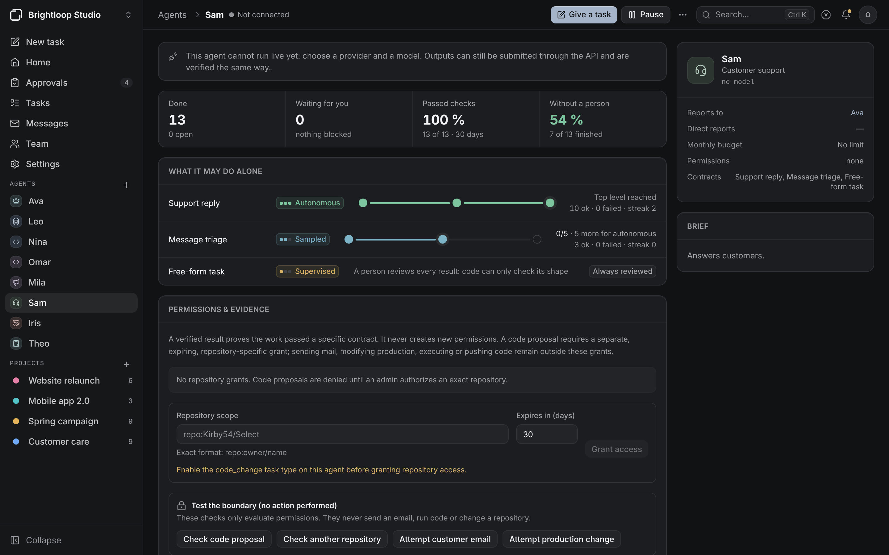
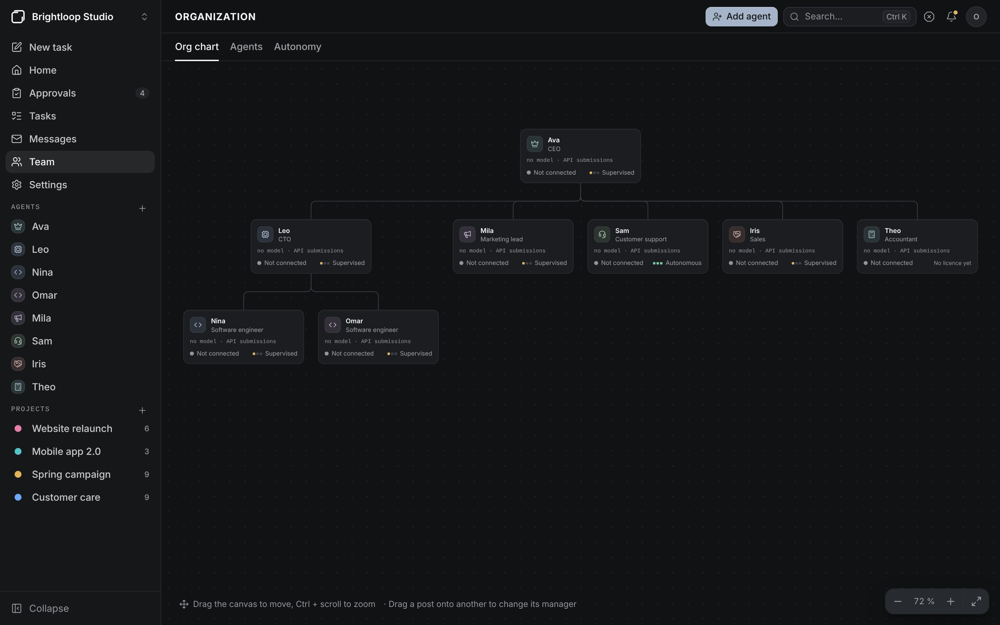
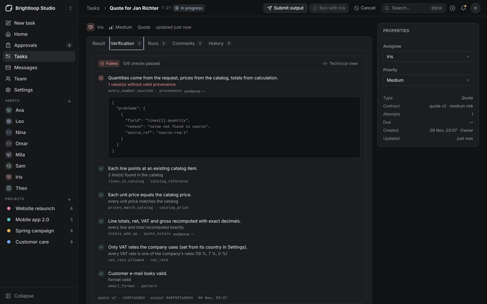
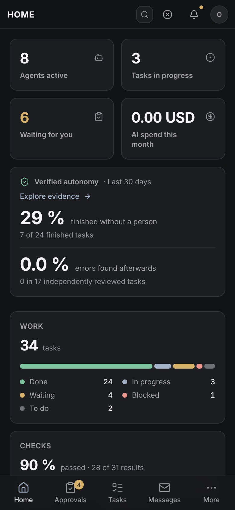
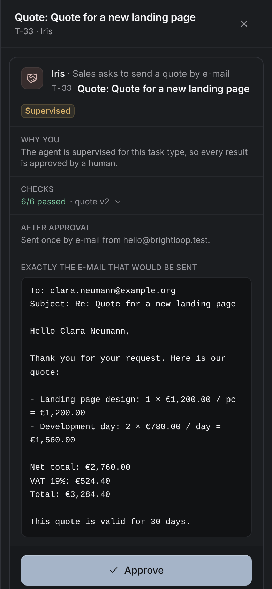

<p align="center">
  
</p>

<p align="center"><strong>Run your company with AI agents that earn their autonomy.</strong><br />
Open source · self-hosted · every result checked by code</p>

<p align="center">
  <a href="#quickstart"><strong>Quickstart</strong></a> ·
  <a href="docs/getting-started.md"><strong>Docs</strong></a> ·
  <a href="#see-it-work"><strong>Screenshots</strong></a> ·
  <a href="#limits"><strong>Limits</strong></a> ·
  <a href="docs/fr/README.md"><strong>Français</strong></a>
</p>

<p align="center">
  <a href="https://github.com/Kirby54/Select/actions/workflows/ci.yml"></a>
  <a href="LICENSE"></a>
  <a href="packages/select-verify/LICENSE"></a>
  <a href="CHANGELOG.md"></a>
</p>

## What is Select?

Select is a control room for a company that works with AI agents of any kind: developers, marketers, support, sales,
accounting. You design the organization, hand out work, and decide what leaves the company.

The difference: **agents do not get autonomy because someone ticked a box. They earn it.** Every result is checked by
code against a delivery contract and keeps a receipt. An agent stops needing your approval for a type of work only once
its verified record shows it can, and loses that licence at the first blocking error. Payments, signatures, hiring and
taxes always stay with a person.

<p align="center">
  
</p>

> **Try it in five minutes, without an API key.** [Start Select](#quickstart) and create the owner account. Then open
> the **demo company** (account menu → *Run demo week*), or create the sample company shown on this page with
> `uv run python scripts/sample-company.py` ([how](docs/getting-started.md)).
>
> **Status: 1.0.0, self-hosted core.** Task management, deterministic verification and approvals are covered by
> automated tests, including a Docker Compose start on Ubuntu CI. This is **not a production-safety certification**:
> native OAuth mail, sandboxed coding execution and independently verified paid-provider runs are not available or not
> verified yet. See the [release notes](release/1.0.0-notes.md) and [Limits](#limits).

## Why Select

Multi-agent orchestrators let you decide in advance what agents may do alone. Select replaces that guess with evidence:

- **Delivery contracts.** Each task type has a YAML contract. The system runs its checks itself and keeps a **receipt** — contract version and hash, every check, the evidence. A model never declares that a check passed.
- **Autonomy earned per agent and task type.** Supervised → sampled → autonomous after a streak of verified successes; back to supervised at the first blocking failure or human correction.
- **Limits the score never overrides.** Payments, contracts, taxes and hiring are always supervised, in code.
- **An honest counter.** The share of work finished without a person is always shown next to the rate of errors people found afterwards.
- **No invented numbers.** Every value carries its source; a quantity that is not in the customer's e-mail fails verification.

<p align="center">
  
</p>

Both diagrams are SVG and can be reviewed or edited directly in the repository.

## What it does

| | |
| --- | --- |
| Start | First visit creates the owner; guided setup: country (VAT, currency, time zone, language), a starting team, an AI model, a mailbox, a catalog |
| Agents | Any role and model (Anthropic, OpenAI, Gemini, Ollama), org chart, permissions, budgets; a submission API for agents that run elsewhere |
| Work | Tasks from you, from incoming e-mail or from routines; list and board, projects, goals, comments, history |
| Mail | Reads a real mailbox (IMAP), triages, routes by code, prepares replies and quotes, sends once over SMTP after approval |
| Verification | `select-verify`: deterministic rules, exact-decimal money, VAT rates, provenance, receipts |
| Autonomy | Licences, promotion and demotion with reasons, sampling, risk caps, revocation, the counter |
| Approvals | The exact e-mail or content that would leave Select, the reason a person is asked, the proof |
| Team | Password sign-in, invitations, roles, API tokens |
| Operations | Costs and budgets with hard stop, emergency stop, audit log with CSV export |
| Demo | A recorded week in a fictional workshop, no API key |


<!-- SELECT_SCREENSHOTS_BEGIN -->
## See it work

Real captures of Select running **Brightloop Studio**, a sample company that
[`scripts/sample-company.py`](scripts/sample-company.py) creates through the public API:
8 agents, 4 projects, 3 routines and a mailbox on local test servers. The agents' results were written
by the script and handed in through the submission API, so **no model was called**. Everything else is
Select at work: it verified each result, kept the receipts, asked for approvals, moved the licences,
triaged the incoming e-mail and sent the approved replies once over SMTP.
Refresh them with the *Refresh real README screenshots* workflow.

<table>
  <tr>
    <td width="50%"><strong>Exactly what would leave</strong><br /></td>
    <td width="50%"><strong>An agent's record</strong><br /></td>
  </tr>
  <tr>
    <td width="50%"><strong>All the work</strong><br /></td>
    <td width="50%"><strong>The team</strong><br /></td>
  </tr>
  <tr>
    <td width="50%"><strong>E-mail in, work out</strong><br /></td>
    <td width="50%"><strong>No invented numbers</strong><br /></td>
  </tr>
  <tr>
    <td width="50%"><strong>Autonomy, earned</strong><br /></td>
    <td width="50%"><strong>Work on a schedule</strong><br /></td>
  </tr>
</table>

<p align="center">
  
  
</p>

<!-- SELECT_SCREENSHOTS_END -->

## Quickstart

Requirements: Docker Desktop (Windows, macOS) or Docker Engine with Compose (Linux).

```bash
git clone https://github.com/Kirby54/Select.git select
cd select
./start.sh                 # Windows: .\start.ps1
```

The script writes `.env` with random secrets (keep a copy), starts the containers and opens <http://localhost:3000>, where the first visit creates your account. Without the script: `cp .env.example .env`, set the secrets, `docker compose up --build`.

No API key yet? Open the demo company from the account menu and press **Run demo week**.

Five-minute guide: [docs/getting-started.md](docs/getting-started.md). Development setup without Docker: [docs/installation.md](docs/installation.md).

## How autonomy works

| Level | A verified result… |
| --- | --- |
| Supervised | goes to a person |
| Sampled | goes to a person if picked (default 20 %), otherwise finishes |
| Autonomous | finishes; a person can revoke the licence at once |

Default promotion thresholds are 20 and 50 verified successes in a row — **starting hypotheses to calibrate, not proven values**. An e-mail to an address that never wrote to you always goes to a person. Details: [docs/autonomy.md](docs/autonomy.md).

## A contract

```yaml
id: support_reply
version: 1
title: Support reply
risk: medium
required: [to, subject, body]
checks:
  - id: recipient_from_message
    rule: provenance          # the address must be the one that wrote to us
    params: { fields: [to] }
  - id: no_unauthorised_promises
    rule: forbidden_phrases
    params: { field: body, phrases: ["refund", "discount", "guarantee"] }
approval:
  mode: by_autonomy
  external_action: send_email
```

More in [docs/verification.md](docs/verification.md).

## Architecture

Next.js 16 web app → FastAPI API → PostgreSQL 16, with a worker on a durable PostgreSQL job queue that runs agents, reads mailboxes, sends approved e-mail and fires routines. `select-verify` is a separate Python library with no database or network access. See [docs/architecture.md](docs/architecture.md) and the interface's [design system](docs/design-system.md).

## Security

Agents never hold a permission to send, pay or sign; the server applies the approval rules and sends. External content is treated as data and checked against stored sources. Passwords use Argon2id; sessions live in an HttpOnly cookie with an anti-forgery header; provider keys and mailbox passwords are encrypted. Read [docs/security.md](docs/security.md) and [docs/deployment.md](docs/deployment.md) before opening Select to a network.

## Tests

```bash
make test     # Python verifier/API tests on PostgreSQL plus frontend unit tests
make e2e      # Playwright UI scenarios against a running stack
```

`e2e/complete.spec.ts` (4 more scenarios) runs on a password-mode stack with the local mail servers of `scripts/dev-mail.py`: first owner, guided setup, a real IMAP mailbox, an e-mail triaged, routed, quoted, approved and sent once over SMTP (the `.eml` file is checked), a weekly routine seen from a New York browser on Paris time, and an invited colleague joining.

## Verify a real model (optional)

The CI tests use network doubles, not real provider keys. Before connecting production data, use the explicit [live-provider probe](docs/provider-verification.md) with **your own test credentials**. It sends a harmless fixed JSON-generation prompt and reports whether the chosen model returns the expected result. It never stores the key or accesses company data. Real-provider compatibility is **not yet certified** by the maintainers.

## Benchmarks

None published yet. The protocol (`autonomy-bench`: same tasks and models, autonomy rate and undetected-error rate side by side, compared with a single agent and with Paperclip) is in [bench/README.md](bench/README.md). Until it runs, Select makes no comparative claim. Feature parity is tracked honestly in [docs/parity.md](docs/parity.md).

## Limits

- **Provider calls** have not been exercised against real paid-model APIs (no keys in CI). An Ollama-compatible localhost HTTP stub is used to test the full worker, deterministic verification and approval pipeline; it does not execute a real model.
- **Docker**: GitHub Actions builds both images, starts PostgreSQL, API, worker and web with Compose, and reaches the API health endpoint through the web proxy on Ubuntu. The `start.sh` script itself was tested with a stand-in Docker CLI; real macOS/Windows installations and `start.ps1` have not been exercised in CI.
- **Mailboxes** were tested against local IMAP and SMTP servers, not yet at a real provider. No OAuth: Microsoft 365 and Outlook.com cannot connect yet; Gmail needs an app password.
- **Agents write text and structured results through model APIs.** Code-change proposals can be checked for basic diff structure and sent to mandatory human review, but no repository code is edited, executed or pushed by Select. There is no isolated Claude Code or Codex runtime yet. See [review-only code proposals](docs/code-change-proposals.md).
- Attachments are not read; quotes are sent as e-mail text, without a PDF.
- **No e-invoice**: the invoice draft is not an XRechnung or ZUGFeRD file and is never presented as compliant. Businesses exempt from VAT (*franchise en base*) are not handled properly yet.
- No single sign-on, two-factor authentication, plugins or sandboxed code execution.

## FAQ

**Do I need an API key?** Not to try it: the demo company and the sample company run without one. Agents that do real
work need a model: Anthropic, OpenAI, Gemini, or a local Ollama.

**Can agents write code?** They can propose a diff, which Select checks for structure and sends to a person; nothing is
applied or executed. Running Claude Code or Codex in an isolated workspace, verified by the project's tests, is next on
the roadmap.

**Where does my data go?** Nowhere but your server and the model provider you connect. Provider keys and mailbox
passwords are stored encrypted.

**How does it compare with Paperclip?** Paperclip is a mature orchestrator and is ahead on coding agents, plugins and
agents that organise themselves. Select's bet is narrower: autonomy earned from verified results, value provenance and an
honest error rate. A feature-by-feature comparison is in [docs/parity.md](docs/parity.md); no claim of superiority is
made without a measurement.

## Documentation

[Five minutes](docs/getting-started.md) · [Installation](docs/installation.md) · [Provider probe](docs/provider-verification.md) · [Configuration](docs/configuration.md) · [Mail](docs/mail.md) · [Agents](docs/agents.md) · [Autonomy](docs/autonomy.md) · [Verification](docs/verification.md) · [Workflows and routines](docs/workflows.md) · [Architecture](docs/architecture.md) · [Deployment](docs/deployment.md) · [Security](docs/security.md) · [Troubleshooting](docs/troubleshooting.md) · [Design system](docs/design-system.md) · [Français](docs/fr/README.md)

## Contributing

Start with [CONTRIBUTING.md](CONTRIBUTING.md). Good first contributions: a new contract for a task type you know, or a new deterministic rule — each with one accepted and one rejected example.

## 1.0.0 release readiness

**1.0.0 is a self-hosted core milestone, not an independent production certification.** The higher-assurance, independently reviewed production-readiness checklist remains pending in [release readiness](release/README.md); passing CI alone does not prove the open roadmap integrations or readiness for high-risk environments.

## Roadmap

1. Verify with real model keys and real mailboxes; keep Docker startup, recovery and tests green across supported environments.
2. Coding-agent runtimes: run Claude Code or Codex in a code workspace, verify with the project's tests, approve the exact diff.
3. Run without Docker (embedded database), like a one-command install.
4. Quote PDFs, attachments, OAuth mailboxes, VAT-exempt businesses.
5. Run `autonomy-bench` and publish the raw results.

## Licence

The application (`apps/`) is licensed under **AGPL-3.0-only** ([LICENSE](LICENSE)). The `select-verify` library is licensed under **Apache-2.0** ([packages/select-verify/LICENSE](packages/select-verify/LICENSE)) so that other tools can adopt delivery contracts freely.

## Support

Questions, ideas and bugs: [GitHub Issues](https://github.com/Kirby54/Select/issues/new/choose) (pick the relevant template). Security vulnerabilities: report privately as described in [SECURITY.md](SECURITY.md).
